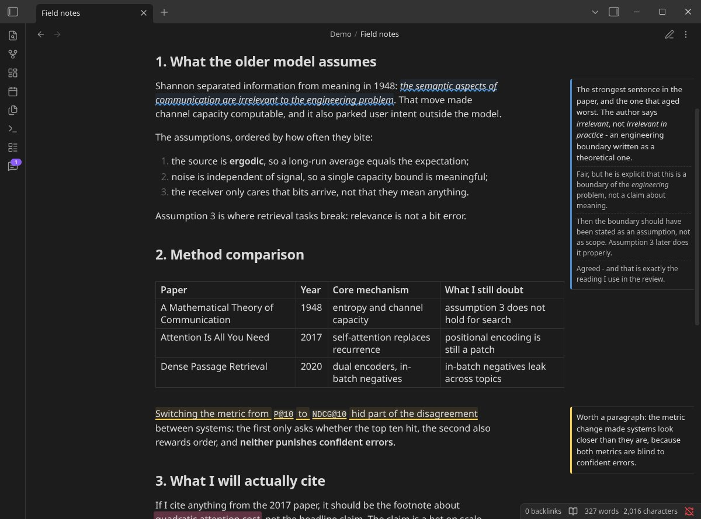
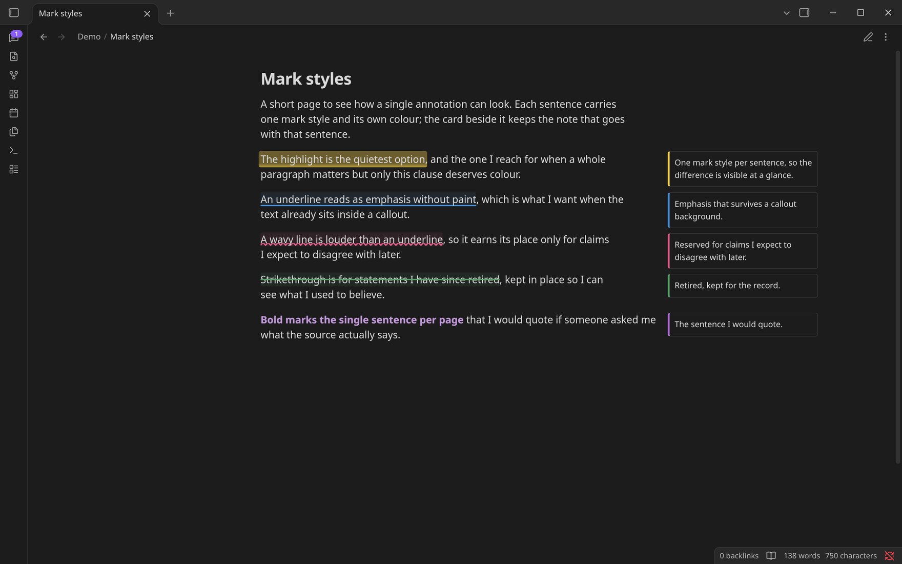
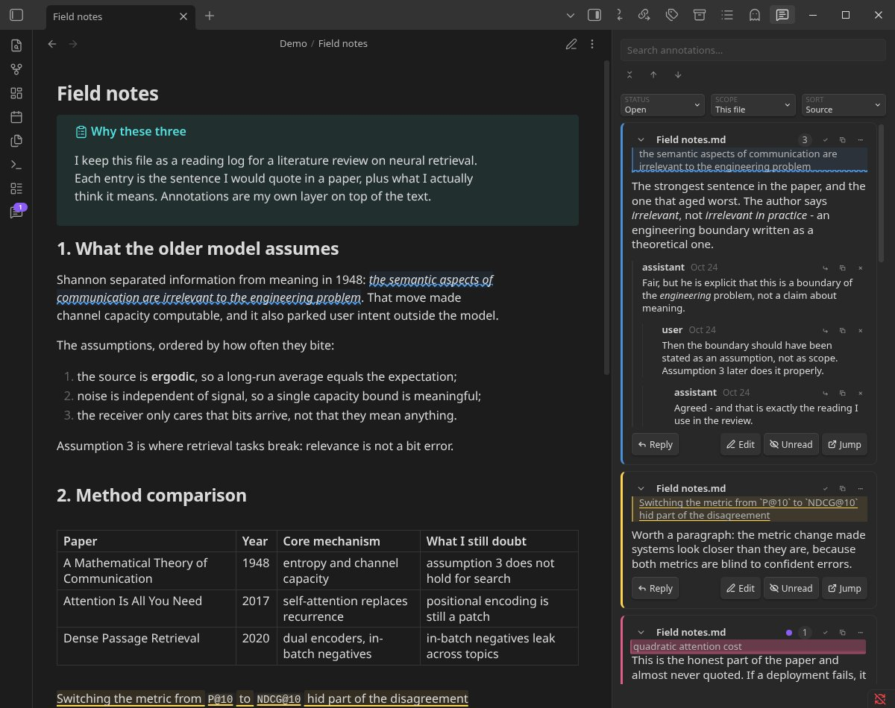

# Marginalia Bona

English | [简体中文](README.zh-CN.md)

Marginalia Bona is a fork of [Siden](https://github.com/giuseqpe/siden) with
per-annotation styling, reply threads, and an agent-friendly index.

Marginalia Bona adds annotations to Markdown notes in Obsidian.

Select a passage, write a Markdown comment in the sidebar, and return to it
later. Markdown annotations can also appear beside the text as margin cards.
Annotations are plain Markdown files inside your vault, and other tools —
AI agents included — can read and write them directly.



https://github.com/user-attachments/assets/1f062ed0-60a9-4612-a936-050a2bbebdb9

A 24-second tour: the cards follow the text as you scroll, hovering a
highlight opens its comment, a selection gets annotated with its own style and
colour, and the sidebar sorts, threads and jumps back to the passage.

## Features

- Select text to annotate; the passage is highlighted in place
- Every annotation lives in one sidebar: view, search, edit, delete. Mark
  annotations resolved when they are handled, and set them back to unresolved
  later
- Margin cards show annotations in the empty space beside the text, in both
  Live Preview and Reading View
- Click a comment to jump to its passage; click a highlight to jump back to
  its comment
- Each annotation can have its own color and mark style (highlight,
  underline, wavy, strikethrough, bold)
- Reply directly under an annotation to form a thread
- Read/unread state: an unread filter, a "mark all read" command, and an
  unread count on the ribbon icon; content written by others turns a thread
  unread again
- Sort by document position, creation date, or last update; search covers the
  whole vault
- Deleted annotations go to a recycle bin (`.marginalia-bona/trash/`) and
  stay restorable for 30 days
- Paste images into the sidebar; they are stored following your attachment
  settings
- Export one note, or the whole vault, to a single readable Markdown file
- Annotations follow the text as it changes: when a passage is rewritten the
  plugin tries to find it again, and marks the annotation orphaned instead of
  pointing at the wrong place
- Source notes are never modified
- An agent bridge: MCP tools and REST endpoints over the Local REST API
  plugin, so AI agents can create and edit annotations safely





## Installation

The plugin is not in the community plugin directory. Install it manually, or
through [BRAT](https://github.com/TfTHacker/obsidian42-brat).

For manual installation, download `main.js`, `manifest.json`, and
`styles.css` from a GitHub release and copy them into:

```text
<vault>/.obsidian/plugins/marginalia-bona/
```

Reload Obsidian, then enable **Marginalia Bona** under
**Settings → Community plugins**.

The data directory `.marginalia-bona/` is separate from upstream Siden's
`.siden/`, so both plugins can coexist in one vault.

## Usage

### Annotate Markdown

1. Select text in Live Preview.
2. Right-click and choose **Add annotation**, or run
   **Marginalia Bona: Add annotation to selection**.
3. Write the comment in the sidebar. `Enter` saves, `Shift+Enter` inserts a
   newline.
4. To reply to an annotation, open it in the sidebar and write below the
   thread.

When a thread needs re-anchoring, start the flow from the sidebar, select its
new location, right-click and choose **Re-anchor annotation here**.

### Add a document comment

Run **Marginalia Bona: Add annotation to current document** without selecting
text. The comment attaches to the note as a whole rather than to a passage.

### Open the sidebar

Run **Marginalia Bona: Open annotations** or use the message icon in the
ribbon.

The sidebar can show annotations for the current file or the entire vault.
Search across comment bodies, replies, quotes, and note paths; filter by
status, author, and read state; sort by position, creation date, or last
update. A reply from someone else, or an annotation added from outside,
turns the thread unread again. That shows in the unread filter and the
ribbon count; new annotations also raise a notice while the sidebar is
closed.

### Deleted annotations

Deleting an annotation moves it to the recycle bin instead of erasing it.
The bin has no sidebar view yet; agents list and restore deleted threads
through the MCP tools or REST endpoints. Entries are purged after 30 days.

### Export

Run **Marginalia Bona: Export this note's annotations to Markdown** for the
current note, or **Export all annotations to Markdown** for the whole vault.
Exports are written to `.marginalia-bona/exports/`.

## Agent access

Agents can read annotations with no setup at all: they are Markdown files in
the vault. Writing is different. An annotation has to be anchored to a quote
and has to keep a specific file layout, so writes go through the plugin.

Both channels — MCP tools and a plain HTTP API — come from the
[Local REST API with MCP](https://github.com/coddingtonbear/obsidian-local-rest-api)
plugin. Marginalia adds no server of its own: it registers its tools and routes
with that plugin, so you keep one key and one port.

### Setup

Install and enable **Local REST API with MCP** first. Its settings tab shows
the API key, the HTTPS port (27124 by default) and an optional HTTP port
(27123, off by default). Agents connect to whichever address you configure
there.

In **Settings → Marginalia Bona → Agent access**, leave **MCP tools** on. Turn
on **REST endpoints** only if you want to call the HTTP API from a script.

> **Note:** with a Local REST API build that predates its extension API,
> Marginalia registers nothing. You get no tools and no routes, and no error
> explaining why.

### MCP

Connect your client to `/mcp/` on the Local REST API server. With default
settings that is `https://127.0.0.1:27124/mcp/`, and the key goes in a bearer
header:

```json
{
  "mcpServers": {
    "obsidian": {
      "url": "https://127.0.0.1:27124/mcp/",
      "headers": { "Authorization": "Bearer <your API key>" }
    }
  }
}
```

The server certificate is signed by a CA that Local REST API generates itself.
Download the CA from `/obsidian-local-rest-api.crt` on the same host and trust
it, or enable the HTTP port and use `http://127.0.0.1:27123/mcp/` instead.
Claude Code, Claude Desktop and Cursor snippets are in the host plugin's
README.

The agent gets eleven `marginalia_*` tools on top of the vault tools the server
already provides:

| Tool | Does |
|---|---|
| `marginalia_list_annotations` | List threads. Filter by `status`, `author`, `read`, `q`; sort with `sort` and `dir`; cap with `limit` |
| `marginalia_create_annotation` | Create a thread anchored to a quote; refuses a quote that occurs more than once unless `occurrence` is given |
| `marginalia_get_annotation` | Read one thread with its replies and read state |
| `marginalia_update_annotation` | Edit the text, status, read state, colour or style; `expected_text` guards the write |
| `marginalia_delete_annotation` | Move a thread to the recycle bin |
| `marginalia_add_reply` | Reply to a thread, or to one reply with `parent_id` |
| `marginalia_update_reply` | Edit one reply |
| `marginalia_delete_reply` | Delete one reply |
| `marginalia_reanchor` | Attach a thread to a different passage, keeping body and replies |
| `marginalia_list_trash` | List recycle-bin entries |
| `marginalia_restore_annotation` | Restore one, re-checking the anchor against the note |

### HTTP

Off by default. With **REST endpoints** on, the same operations are available
under `/vault/<note path>/annotations/`, documented field by field in the
host's `/openapi.yaml`:

| Route | Does |
|---|---|
| `GET`, `POST` `.../annotations/` | List this note's threads, create one. Query: `status`, `author`, `read`, `q`, `sort`, `dir`, `limit` |
| `GET`, `PATCH`, `DELETE` `.../annotations/{id}` | Read, edit, or bin one thread |
| `POST` `.../annotations/{id}/replies` | Append a reply; `parent_id` nests it |
| `PATCH`, `DELETE` `.../annotations/{id}/replies/{replyId}` | Edit or delete one reply |
| `POST` `.../annotations/{id}/reanchor` | Attach the thread to another passage |

```sh
curl -k -X POST -H "Authorization: Bearer <your API key>" -H "Content-Type: application/json" \
  --data '{"text": "Consider a table here", "quote": "the three options", "author": "Pi"}' \
  "https://127.0.0.1:27124/vault/Projects/Plan.md/annotations/"
```

A quote that occurs more than once is refused (40902) until `occurrence` says
which one. An edit whose `expected_text` no longer matches is refused with 409
instead of overwriting a change it never saw.

> **Note:** if the routes answer `40054` ("valid target types are heading,
> block, frontmatter"), the REST toggle is still off. The server never saw
> them.

Threads written under another author turn unread, so an agent's edits show up
in the unread filter and on the ribbon icon. Deleted threads stay in the
recycle bin for 30 days; `marginalia_list_trash` and
`marginalia_restore_annotation` list and restore them.

## Settings

- Highlight visibility, color, opacity, and style
- Margin cards on/off (also a command, so it can have a hotkey), side, and
  maximum width
- Space reservation for margin cards, so they appear whatever the theme does
  with line width; skipped when the pane is too narrow to keep a readable
  column
- Resolved annotation visibility
- Forced wrapping for very long words, links, and code
- Attachments folder for pasted images (follows Obsidian's convention by
  default)
- Agent access: MCP tools on/off, REST endpoints on/off

## Storage

Annotations are stored as individual Markdown files under:

```text
.marginalia-bona/annotations/<source path>/<quote excerpt>-<short id>.md
```

Each file is one thread. A real one, shortened:

````markdown
---
siden-schema: 1
id: "606404a7-9c1e-4b2f-8a57-1d0f6f20b9ce"
source: "Projects/Plan.md"
source-type: "markdown"
status: "open"
author: "Pi"
created: "2026-10-24T09:12:40.245Z"
updated: "2026-10-24T09:14:02.881Z"
---

# Annotation

Consider a table here — three rows for the quarterly numbers.

## Replies

### b71c02de | 2026-10-24T09:14:02.881Z | user

Agreed, but keep the totals in the text.

<!-- siden:anchor -->

## Anchor metadata

```json
{
  "kind": "markdown",
  "startOffset": 284,
  "endOffset": 301,
  "startLine": 11,
  "startCharacter": 23,
  "endLine": 11,
  "endCharacter": 40,
  "quote": {
    "exact": "the three options",
    "prefix": "Consider a table here: ",
    "suffix": "."
  },
  "originalQuote": "the three options"
}
```

<!-- /siden:anchor -->
````

Frontmatter carries identity, status, styling, and read state; the body is
the root comment; replies follow under a `Replies` heading, and a reply that
answers another one carries a `<!-- reply-to: <id> -->` line under its
heading; the fenced JSON block at the end records the anchor. File names are minted when the thread is
created and stay stable afterwards, even when the anchored text drifts.

The `.marginalia-bona/index/` folder holds one JSONL shard per document — a
rebuildable cache that lets agents and the sidebar locate threads without
reading every file. Run **Marginalia Bona: Rebuild annotation index** to
regenerate it.

Deleting an annotation moves it to `.marginalia-bona/trash/` for 30 days.
Source notes are never modified.

## Privacy and permissions

- No telemetry, no ads, no accounts, no network requests of its own.
- Annotation data stays inside the vault in `.marginalia-bona/`.
- The agent bridge talks to the Local REST API plugin on your machine only;
  it adds no listeners of its own.

## Limitations

- The recycle bin has no sidebar view yet; agents reach it over MCP or REST.
- A quote that appears more than once in a note is never anchored on a guess:
  the caller must say which occurrence it means.

## Development

```sh
npm install
npm run dev     # rebuild main.js on change
npm test        # vitest
npm run lint    # eslint
npm run build   # type-check and write main.js
```

To see a build running, copy `main.js`, `manifest.json`, and `styles.css`
into `<vault>/.obsidian/plugins/marginalia-bona/` and reload Obsidian.

## Credits and license

- [Siden](https://github.com/giuseqpe/siden) by Giuseppe, MIT. Marginalia
  Bona keeps the upstream attribution.
- Marginalia Bona is released under the MIT license.
